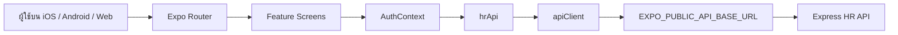
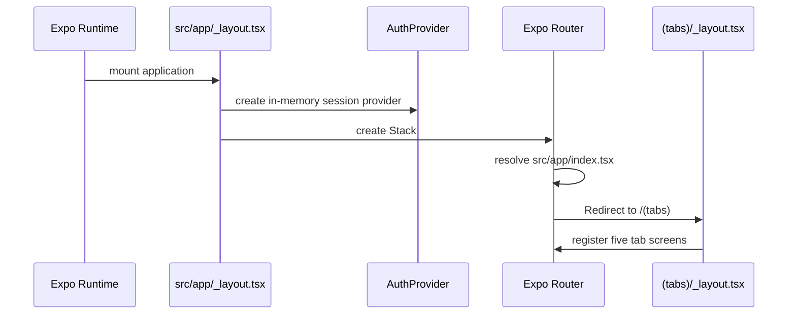
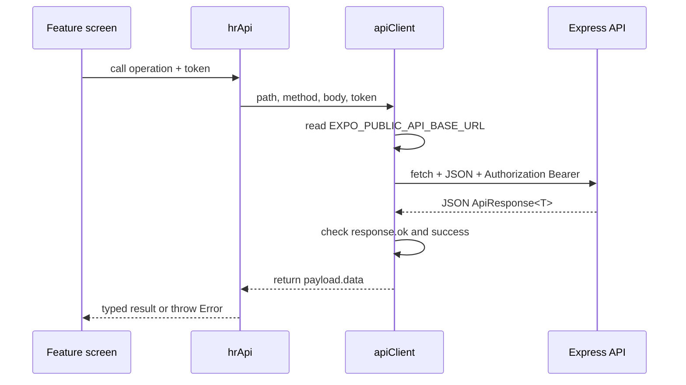
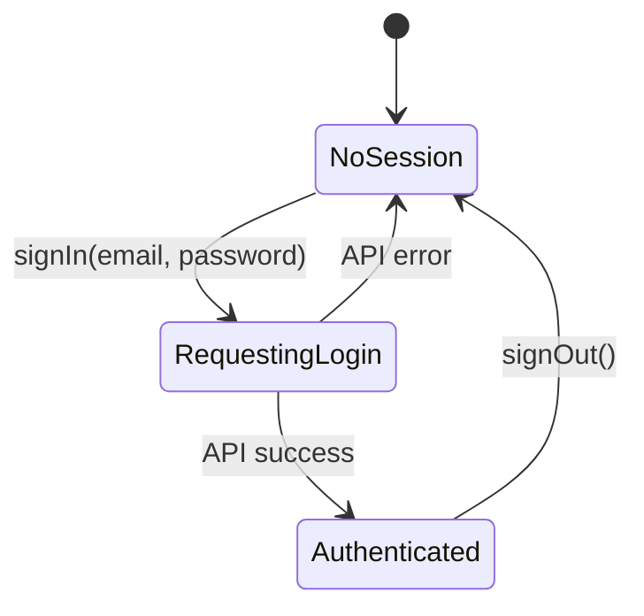

# Frontend System Flow — HR Management

สถานะเอกสาร: อ้างอิงจาก implementation ปัจจุบันใน `frontend/src`

## 1. System boundary



Frontend รับผิดชอบ route, UI state, form interaction และการแนบ Bearer token. Backend รับผิดชอบ authentication, authorization, validation, business rules และข้อมูลถาวร

## 2. Source structure

```text
frontend/
├── src/
│   ├── app/                         # Expo Router routes only
│   │   ├── _layout.tsx              # Root Stack + AuthProvider
│   │   ├── index.tsx                # Redirect ไป /(tabs)
│   │   ├── login.tsx                # Login route
│   │   └── (tabs)/
│   │       ├── _layout.tsx          # Bottom tabs
│   │       ├── index.tsx            # Dashboard route
│   │       ├── attendance.tsx
│   │       ├── leave.tsx
│   │       ├── employees.tsx
│   │       └── profile.tsx
│   ├── features/                    # Screen-specific presentation
│   ├── components/hr/               # HrScreen, SectionCard, StatusBadge
│   ├── context/                     # AuthContext and session state
│   ├── services/                    # apiClient and hrApi
│   ├── types/                       # API/domain TypeScript types
│   └── constants/                   # HR color tokens
├── .env.example                     # API base URL example
└── docs/                            # Frontend flow documents
```

## 3. Boot and routing flow



## 4. API client flow



### Current endpoint mapping

| Frontend method | HTTP request | Status |
| --- | --- | --- |
| `hrApi.login` | `POST /api/auth/login` | ถูกเรียกจาก Login flow |
| `hrApi.getMyAttendance` | `GET /api/attendance/me` | มี service; ยังไม่ผูกหน้าจอ |
| `hrApi.checkIn` | `POST /api/attendance/check-in` | มี service; หน้าจอยังใช้ local state |
| `hrApi.checkOut` | `POST /api/attendance/check-out` | มี service; หน้าจอยังใช้ local state |
| `hrApi.getMyLeaveRequests` | `GET /api/leave-requests/me` | มี service; หน้าจอยังใช้ sample data |
| `hrApi.createLeaveRequest` | `POST /api/leave-requests` | มี service; form ยังไม่เรียก service |
| `hrApi.getEmployees` | `GET /api/employees` | มี service; หน้าจอยังใช้ sample data |

## 5. Authentication state



ปัจจุบัน `AuthContext` เก็บ `{ token, user }` ใน React memory state. `apiClient` แนบ token เมื่อ service ส่ง option `token` มาให้. ยังไม่มี storage, refresh, logout API หรือ handling ของ `401` แบบรวมศูนย์

## 6. Response and error flow

1. `fetch` ส่ง request ไป base URL
2. `apiClient` parse JSON เป็น `ApiResponse<T>`
3. หาก HTTP ไม่ใช่ 2xx หรือ `success` เป็น `false` จะ throw `Error`
4. Login จับ error และแสดง `Alert`
5. Feature อื่นยังไม่มี error boundary หรือ inline error state แบบเฉพาะหน้าจอ

## 7. UI state ownership

| State | เจ้าของปัจจุบัน | หมายเหตุ |
| --- | --- | --- |
| Session | `AuthContext` | in-memory เท่านั้น |
| Login input/loading | `login.tsx` | local component state |
| Check-in/out status | `attendance-screen.tsx` | local demo state |
| Leave list/modal/reason | `leave-screen.tsx` | local demo state |
| Theme tokens | `constants/hr-theme.ts` | shared constants |
| API base URL | `services/api-client.ts` | environment variable |

## 8. Security boundaries

- ห้ามเก็บ password ใน session หรือ response
- token ต้องส่งเฉพาะผ่าน `Authorization: Bearer <token>`
- role permission ต้องบังคับซ้ำที่ backend; การซ่อน tab ใน frontend ไม่ใช่ security boundary
- production ควรเพิ่ม secure token storage และเคลียร์ session เมื่อ logout/หมดอายุ

## 9. Implementation gaps

- เพิ่ม route guard ตาม session
- เชื่อมปุ่ม attendance กับ `hrApi.checkIn/checkOut`
- โหลดรายการ leave และ employees จาก API จริง
- เพิ่ม form fields และ validation ของ leave request
- เพิ่ม centralized handling สำหรับ `401`, network timeout และ empty/error states
- ยืนยัน schema จริงของ Employee และ API pagination ก่อนลบ sample data
