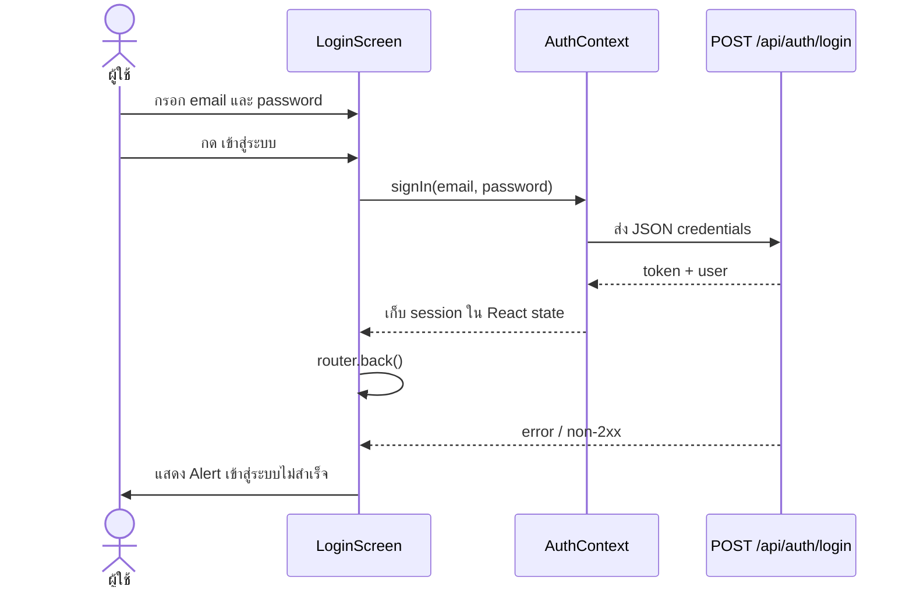
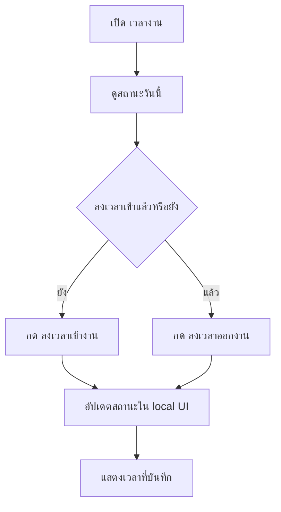
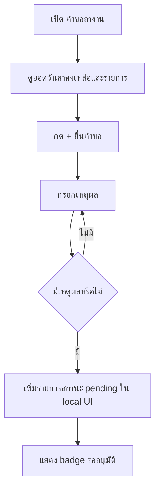

# Frontend User Flow — HR Management

สถานะเอกสาร: อ้างอิงจาก source code frontend ปัจจุบัน  
ขอบเขต: Expo Router + React Native สำหรับ HR Management

## 1. ขอบเขตที่ตรวจพบ

Frontend มีหน้าจอหลัก 6 กลุ่ม:

| หน้าจอ | Route | ความรับผิดชอบ |
| --- | --- | --- |
| Dashboard | `/(tabs)` | ภาพรวมทีมและรายการที่ต้องติดตาม |
| เวลางาน | `/(tabs)/attendance` | แสดงสถานะและกด check-in/check-out |
| คำขอลา | `/(tabs)/leave` | ดูรายการและเปิดฟอร์มยื่นคำขอ |
| ทีมงาน | `/(tabs)/employees` | แสดงรายชื่อทีมสำหรับ Manager/Admin flow |
| โปรไฟล์ | `/(tabs)/profile` | แสดงข้อมูลบัญชีและออกจากระบบ |
| Login | `/login` | รับ email/password และเรียก login API |

Route ถูกประกาศผ่าน `src/app` ตาม file-based routing ของ Expo Router; ส่วน UI จริงอยู่ใน `src/features` และ reusable UI อยู่ใน `src/components/hr`

## 2. Initial flow

```mermaid
flowchart TD
    A[เปิดแอป] --> B[src/app/index.tsx]
    B --> C[Redirect ไป /(tabs)]
    C --> D[Dashboard]
    D --> E[เลือก tab เวลางาน]
    D --> F[เลือก tab คำขอลา]
    D --> G[เลือก tab ทีมงาน]
    D --> H[เลือก tab โปรไฟล์]
    D -. ไป /login โดยตรง .-> I[Login]
```

ข้อเท็จจริงจาก implementation: root redirect ไป `/(tabs)` เสมอ และยังไม่มี route guard ที่บังคับให้ login ก่อนเห็น tabs. `/login` จึงเป็น route ที่เปิดโดยตรงได้ในตอนนี้

## 3. Login flow



สิ่งที่ทำแล้ว:

- แสดง loading state ระหว่าง request
- แสดง `Alert` เมื่อ API error
- ส่ง token และ user เข้า `AuthContext`
- `signOut` ล้าง session ใน memory

สิ่งที่ยังไม่ทำ:

- ไม่มี persistent storage เมื่อปิดแอป
- ยังไม่มี automatic redirect เมื่อ token หมดอายุ
- ยังไม่มีปุ่มจาก Dashboard ไป `/login` ใน UI ปัจจุบัน

## 4. Dashboard flow

ผู้ใช้เปิด Dashboard แล้วเห็น greeting, วันที่, จำนวนพนักงาน, จำนวนลางานวันนี้ และคำขอรออนุมัติ โดยข้อมูลปัจจุบันเป็นตัวอย่าง UI ใน `dashboard-screen.tsx`; ยังไม่มีการเรียก `GET` endpoint เพื่อแทนที่ข้อมูลตัวอย่าง

## 5. Attendance flow



`hrApi` เตรียม endpoint `POST /api/attendance/check-in`, `POST /api/attendance/check-out` และ `GET /api/attendance/me` ไว้แล้ว แต่ปุ่มในหน้าจอปัจจุบันยังเปลี่ยน local state เท่านั้น ต้องเชื่อม service ในขั้นตอนถัดไป

## 6. Leave request flow



ฟอร์มปัจจุบันยังรับเพียงเหตุผลและใช้วันที่ placeholder. ก่อนเชื่อม `POST /api/leave-requests` ต้องเพิ่ม `leave_type`, `start_date`, `end_date` และ validation ตาม API contract

## 7. Employee/Manager flow

หน้า `ทีมงาน` แสดงรายชื่อข้อมูลตัวอย่างและระบุว่าใช้สำหรับ Manager/Admin. Service เตรียม `GET /api/employees` และส่ง token ได้แล้ว แต่หน้าปัจจุบันยังไม่ได้โหลดข้อมูลจาก service และยังไม่มี role-based route guard ใน UI

## 8. Profile and sign-out flow

ผู้ใช้เปิด `โปรไฟล์` เพื่อดูชื่อ, email, แผนก และ role. หากมี session จะแสดงปุ่ม `ออกจากระบบ`; เมื่อกดจะเรียก `signOut()` และล้าง session จาก `AuthContext` เท่านั้น

## 9. สถานะที่ต้องยืนยัน/พัฒนาต่อ

1. ต้องกำหนดว่า unauthenticated user จะถูก redirect ไป `/login` หรือไม่
2. ต้องกำหนด persistent token storage และ token refresh
3. ต้องยืนยันว่า Manager/Admin เห็น tabs ทีมงานเหมือนกันหรือใช้ feature guard
4. ต้องเชื่อม attendance และ leave UI กับ API จริง
5. ต้องยืนยัน date picker, leave quota และ validation จากโจทย์ธุรกิจ
